<div align="center">

# Person Anonymizer by Bonn

**Automatic person anonymization in surveillance videos using YOLO v8 multi-scale detection, ByteTrack tracking, and temporal smoothing.**

Created by <a href="https://andreabonn.github.io/" target="_blank">Andrea Bonacci</a>

[](https://github.com/AndreaBonn/video-anonimyzer/actions/workflows/ci.yml)
[](https://github.com/AndreaBonn/video-anonimyzer/actions/workflows/ci.yml)
[](https://github.com/AndreaBonn/video-anonimyzer/actions/workflows/ci.yml)
[](LICENSE)
[](https://github.com/astral-sh/ruff)
[](SECURITY.md)

[English](#english) | [Italiano](#italiano)

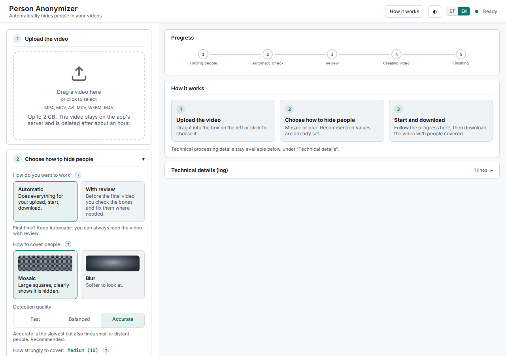

</div>

---

<a id="english"></a>
## English

[Passa all'italiano](#italiano)

### What it does

CLI and web tool that finds people in a video and covers them with a mosaic or a blur. Designed for fixed cameras with wide-angle lenses, where people may appear small (30-100 px). Everything runs locally: no video leaves the machine.

### Architecture

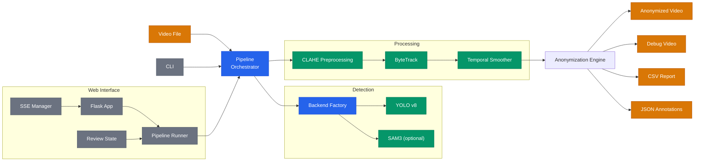

### Features

- **Multi-scale YOLO v8 detection**: inference at 4 scales (1.0x-2.5x) + 3x3 sliding window + Test-Time Augmentation
- **ByteTrack tracking**: persistent person IDs across consecutive frames
- **Temporal smoothing (EMA)**: stabilizes boxes with a moving average; ghost boxes keep people covered during short occlusions
- **Automatic check and refinement**: re-analyzes the rendered video and adds the people it missed (up to 3 passes)
- **Manual review**: add, close and delete areas frame by frame, in the browser (web) or in an OpenCV window (CLI)
- **Two anonymization methods**: pixelation (mosaic, default) or Gaussian blur
- **Adaptive intensity**: small, distant people get stronger obscuring
- **Resume saved work**: reload the JSON annotations of a previous run and review them again, or turn them into rectangles and render directly
- **Complete output set**: anonymized H.264 video with original audio, debug video, CSV report, reusable JSON annotations
- **Optional SAM3 backend**: pixel-precise masks instead of boxes (see [SAM3 Backend](#sam3-backend-optional))

### Requirements

- Python 3.11+ (3.12+ for the SAM3 backend)
- ffmpeg (H.264 encoding and audio preservation)
- ~150 MB disk space for the YOLO models (downloaded automatically on first run)
- CUDA GPU recommended; CPU also works (CUDA required for the SAM3 modes)

**Install ffmpeg:**

```bash
# Ubuntu/Debian
sudo apt install ffmpeg

# macOS
brew install ffmpeg

# Windows (Chocolatey)
choco install ffmpeg
```

### Installation

```bash
git clone https://github.com/AndreaBonn/video-anonimyzer.git
cd video-anonimyzer
python -m venv .venv
source .venv/bin/activate
# Windows: .venv\Scripts\activate
pip install -e .
```

`pip install -e .` installs the pinned dependencies and the `person-anonymizer` command. `requirements.txt` holds the same production pins, `requirements-dev.txt` adds the test and lint tools.

### Web Interface

```bash
python -m person_anonymizer.web.app
# Open http://127.0.0.1:5000
```

The page guides a first-time user through three steps: upload the video, choose how to hide people, start and download. The recommended values are already set, so a video can be processed without touching any setting.

<p align="center">
  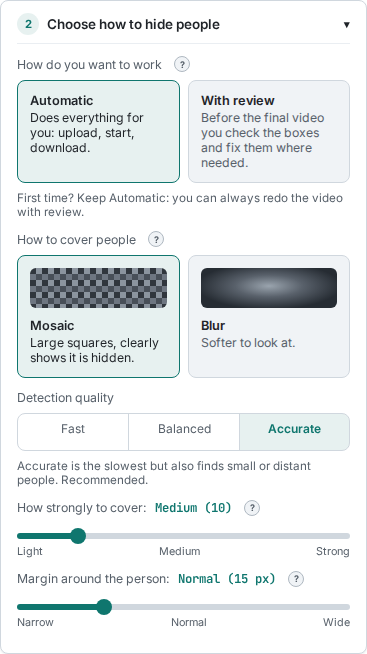
  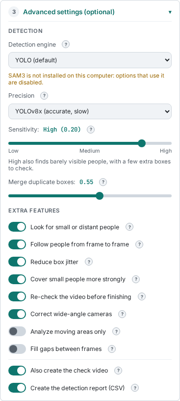
</p>

**1. Upload the video.** Drag and drop or click to select (MP4, MOV, AVI, MKV, WEBM, M4V, up to 2 GB). The card shows a thumbnail, duration and resolution.

**2. Choose how to hide people.**

| Setting | Options | Notes |
|---------|---------|-------|
| How do you want to work | **Automatic** (default in the web UI) or **With review** | With review stops before the final video so you can check the areas |
| How to cover people | **Mosaic** or **Blur** | Visual preview on each choice |
| Detection quality | **Fast**, **Balanced**, **Accurate** (default) | Fast = YOLOv8n without sliding window; Balanced = YOLOv8n + sliding window; Accurate = YOLOv8x + sliding window |
| How strongly to cover | Light to Strong | `anonymization_intensity` |
| Margin around the person | Narrow to Wide | `person_padding` in px |

**3. Advanced settings (optional, closed by default).** Detection engine (YOLO, YOLO + SAM3, SAM3; the SAM3 options are disabled when SAM3 is not installed), YOLO model, sensitivity (mapped to the YOLO confidence threshold: higher sensitivity means a lower threshold), merging of duplicate boxes (NMS IoU), and the extra functions: small or distant people (sliding window), tracking, smoothing, adaptive intensity, final check, wide-angle correction, motion-only analysis, sub-frame interpolation, debug video and CSV report.

**Resume saved work.** Upload the same video first, then the `*_annotations.json` of a previous run: detection is skipped and the review opens in the browser. With "Turn areas into rectangles" (same as `--normalize`) the areas become rectangles, overlapping ones are merged, and the video is rendered without a review.

**Progress.** Five phases with a progress bar, time estimate and frame counter. Settings are locked while a job runs; Stop asks for confirmation. Reloading the page reattaches it to the job still running, so it can be followed or stopped. The server runs one job at a time.

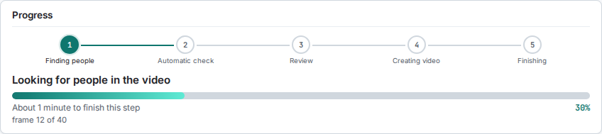

**Manual review in the browser.** Green areas were found automatically, orange ones were added by you. Draw an area point by point, close it, delete wrong areas, jump to the next frame with people. Every edit is saved on the server; an edit the server rejects is rolled back on screen.

<p align="center">
  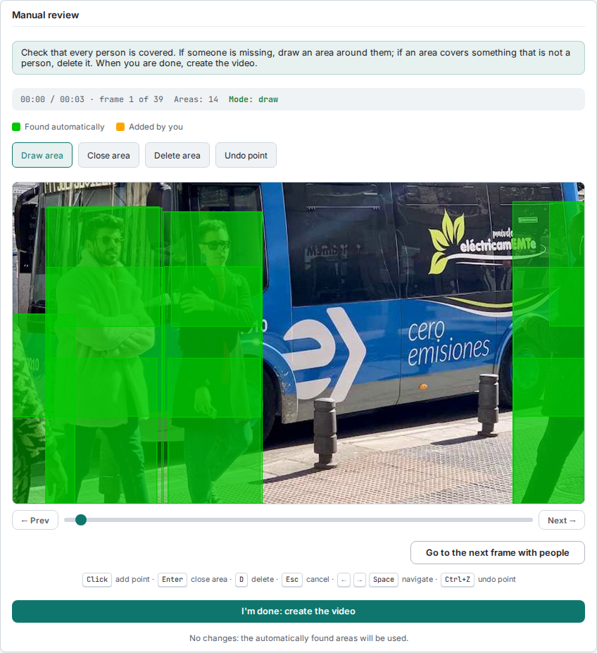
</p>

| Key | Action |
|-----|--------|
| Click | Add a point |
| Enter | Close the area |
| D | Delete mode |
| Esc | Cancel the area being drawn |
| Left / Right, Space | Previous / next frame |
| Ctrl+Z | Undo the last point |

**Results.** Preview player, download of the anonymized video, outcome of the automatic check, and the other files (resume file, debug video, CSV report). Files are deleted after about one hour.

<p align="center">
  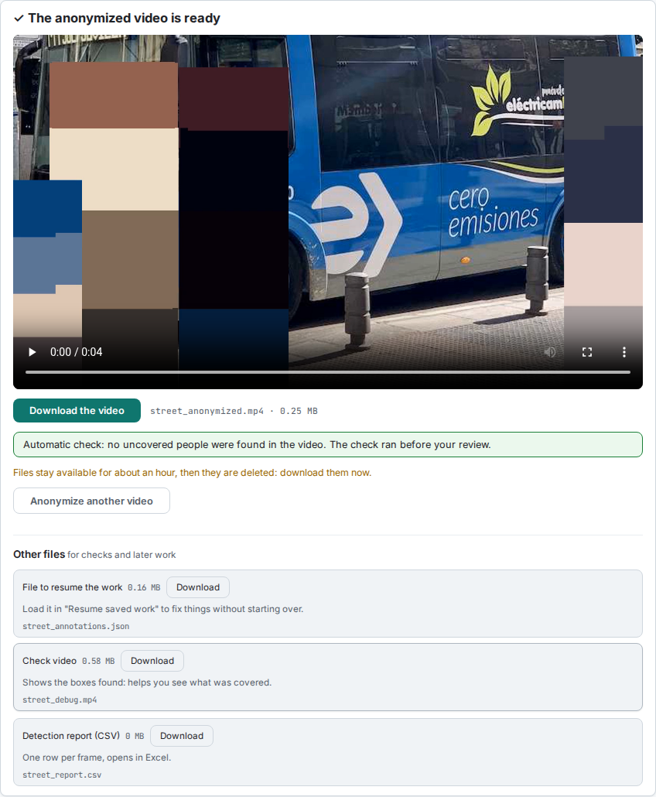
</p>

The interface is available in Italian and English, in light and dark theme (it follows the system setting until you pick one). A "How it works" button reopens the guide, and the technical log stays available under "Technical details" with absolute paths removed.

<p align="center">
  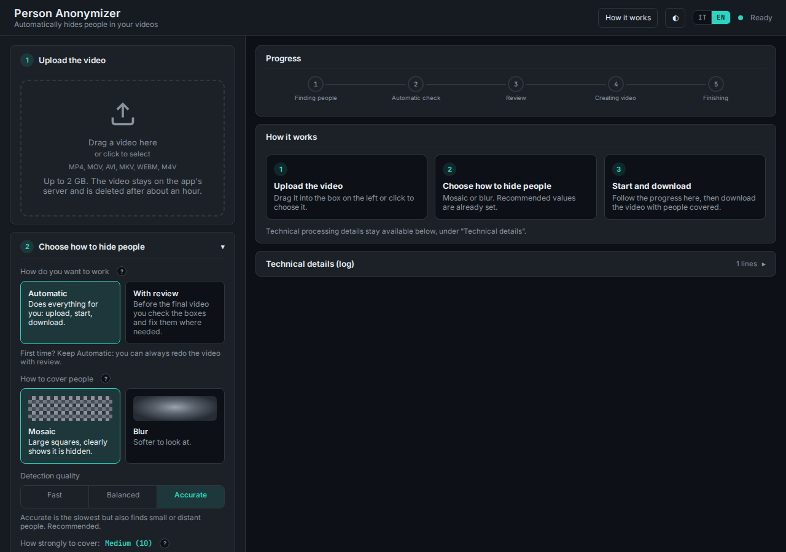
</p>

**Environment variables:**

| Variable | Description | Default |
|----------|-------------|---------|
| `FLASK_SECRET_KEY` | Secret key for Flask sessions | Random (generated at startup, with a warning) |
| `FLASK_HOST` | Web server host | `127.0.0.1` |
| `FLASK_PORT` | Web server port | `5000` |

### CLI Usage

```bash
# Standard: automatic detection + manual review (CLI default)
python -m person_anonymizer.cli video.mp4
# or, after pip install -e .
person-anonymizer video.mp4

# Fully automatic (no manual review)
python -m person_anonymizer.cli video.mp4 -M auto

# Specify output and method
python -m person_anonymizer.cli video.mp4 -o output.mp4 -m blur

# Disable debug video and CSV report
python -m person_anonymizer.cli video.mp4 --no-debug --no-report

# Reload JSON annotations and reopen the review (detection is skipped)
python -m person_anonymizer.cli video.mp4 --review annotations.json

# Normalize annotations (polygons to rectangles, overlaps merged) and render without review
python -m person_anonymizer.cli video.mp4 --review annotations.json --normalize
```

**CLI options:**

| Option | Description | Default |
|--------|-------------|---------|
| `input` | Path to input video | (required) |
| `-M, --mode` | `manual` (with review) or `auto` | `manual` (from `PipelineConfig`) |
| `-o, --output` | Output file path | `<input>_anonymized.mp4` |
| `-m, --method` | `pixelation` or `blur` | `pixelation` (from `PipelineConfig`) |
| `--backend` | Detection backend: `yolo`, `yolo+sam3`, `sam3` | `yolo` |
| `--no-debug` | Disable debug video | `False` |
| `--no-report` | Disable CSV report | `False` |
| `--review` | Reload annotations from JSON | `None` |
| `--normalize` | Turn polygons into rectangles and skip the review (requires `--review`) | `False` |

**CLI review window (OpenCV):** click to add a point, Enter to close the area, D to toggle delete mode, Esc to cancel, Left/Right or Space to move between frames, Ctrl+Z or Backspace to undo a point, Q to finish.

### Pipeline (5 phases)

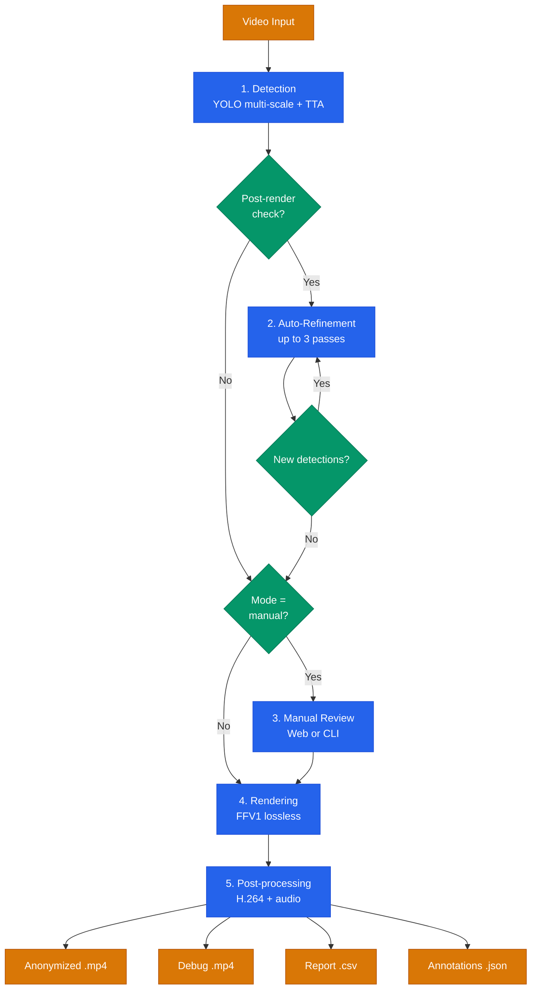

| # | Phase | Web label | What happens |
|---|-------|-----------|--------------|
| 1 | Detection | Finding people | YOLO multi-scale + sliding window + TTA, tracking and smoothing; optional motion detection. Skipped when annotations are reloaded from JSON |
| 2 | Auto-refinement | Automatic check | Renders, runs a second YOLO pass on the result and adds missed people, up to 3 iterations |
| 3 | Manual review | Review | Browser editor or OpenCV window; skipped in automatic mode |
| 4 | Rendering | Creating video | Applies the obscuring to the original frames (FFV1 lossless intermediate) |
| 5 | Post-processing | Finishing | H.264 encoding with ffmpeg, original audio, debug video, report and JSON |

### Output Files

| File | Description |
|------|-------------|
| `*_anonymized.mp4` | Video with people obscured (H.264, original audio) |
| `*_debug.mp4` | Video with colored detection overlays |
| `*_report.csv` | One row per frame: people detected, average/min/max confidence, motion zones, sliding window and multi-scale hits, post-check alerts |
| `*_annotations.json` | Full annotations, reusable with `--review` or "Resume saved work" |

### Supported Formats

`.mp4`, `.m4v`, `.mov`, `.avi`, `.mkv`, `.webm`

### SAM3 Backend (Optional)

In addition to the default YOLO pipeline, Person Anonymizer supports **SAM3 (Segment Anything Model 3 by Meta)** as an optional detection and segmentation backend, providing pixel-precise person masks instead of bounding boxes.

| Mode | Description | GPU Requirement |
|------|-------------|-----------------|
| `yolo` | Default: YOLO v8 multi-scale (fast, battle-tested) | CUDA recommended, CPU supported |
| `yolo+sam3` | Hybrid: YOLO detects, SAM3 refines the masks | CUDA **required** |
| `sam3` | Full SAM3: detection and segmentation by SAM3 | CUDA **required**, 8+ GB VRAM |

```bash
# Install the SAM3 dependencies (Python 3.12+)
pip install -r requirements-sam3.txt
# or
pip install -e '.[sam3]'

# Hybrid mode
python -m person_anonymizer.cli video.mp4 --backend yolo+sam3

# Full SAM3 mode
python -m person_anonymizer.cli video.mp4 --backend sam3
```

In the web interface the engine is chosen under "Advanced settings". The page asks the server whether SAM3 is installed and disables the SAM3 options when it is not; with full SAM3 the YOLO model selector is hidden.

### Advanced Configuration

All parameters (about 50) live in `PipelineConfig` (`person_anonymizer/config.py`), validated in `__post_init__`. The web interface exposes the most useful ones. Key parameters:

| Parameter | Description | Default | Range |
|-----------|-------------|---------|-------|
| `operation_mode` | `manual` or `auto` | `manual` | |
| `detection_confidence` | YOLO confidence threshold | 0.20 | 0.01-0.99 |
| `anonymization_intensity` | Obscuring strength | 10 | 1-100 (web: 2-50) |
| `person_padding` | Padding around the person (px) | 15 | 0-200 (web: 0-60) |
| `yolo_model` | YOLO model | `yolov8x.pt` | `yolov8x.pt`, `yolov8n.pt` |
| `enable_sliding_window` | 3x3 sliding window grid | `True` | |
| `enable_tracking` | ByteTrack tracking | `True` | |
| `track_max_age` | Frames a lost track is kept | 45 | web: 1-300 |
| `enable_temporal_smoothing` | EMA + ghost boxes | `True` | |
| `smoothing_alpha` | EMA weight (1 = no smoothing) | 0.35 | 0.01-1.0 |
| `ghost_frames` | Ghost frames for occlusions | 10 | 0-120 |
| `enable_adaptive_intensity` | Intensity proportional to size | `True` | |
| `enable_post_render_check` | Automatic check and refinement | `True` | |
| `max_refinement_passes` | Auto-refinement iterations | 3 | 1-10 |
| `enable_motion_detection` | Run the sliding window only on moving areas (multi-scale still covers the whole frame) | `False` | |
| `enable_subframe_interpolation` | Fill gaps between frames | `False` | |

**Fish-eye correction** needs a camera calibration: run `python -m person_anonymizer.camera_calibration --images ./calibration_images/` on chessboard photos, then set `camera_matrix` and `dist_coefficients` in `PipelineConfig`. Neither the CLI nor the web interface loads a calibration file, so without these two values the correction toggle has no effect.

### Project Structure

```
person_anonymizer/
├── config.py              # PipelineConfig with validation, VERSION
├── models.py              # Dataclasses (PipelineContext, OutputPaths, ...) and exceptions
├── pipeline.py            # Orchestrator: phase order, stop checks, capture lifecycle
├── pipeline_report.py     # Output paths, banner and printed summary
├── stage_detection.py     # Detection loop (YOLO + tracking + smoothing, optional SAM3 refiner)
├── detection_report.py    # Per-frame report rows and detection totals
├── stage_refinement.py    # Automatic check and refinement loop
├── stage_review.py        # Manual review (web or CLI)
├── backend_factory.py     # Backend selection: yolo / yolo+sam3 / sam3
├── sam3_backend.py        # Optional SAM3 backend
├── detection.py           # YOLO multi-scale + NMS
├── tracking.py            # ByteTrack + TemporalSmoother
├── anonymization.py       # Obscuring + polygon geometry
├── preprocessing.py       # CLAHE, fisheye, motion detection
├── postprocessing.py      # H.264 encoding, post-render check
├── normalization.py       # Polygon merging and annotation normalization
├── rendering.py           # Video rendering + review stats
├── output.py              # Output saving and JSON loading
├── manual_reviewer.py     # OpenCV review window
├── review_editor.py       # Review editor state and actions (pure)
├── review_drawing.py      # Overlay and status bar drawing (pure)
├── camera_calibration.py  # Camera calibration utility
├── cli.py                 # CLI entry point
└── web/                   # Flask web interface (Blueprints)
    ├── app.py             # Upload/start/stop/status routes, SSE stream, cleanup thread
    ├── routes_review.py   # Review endpoints
    ├── routes_output.py   # Download, defaults and capabilities endpoints
    ├── pipeline_runner.py # Background thread around run_pipeline
    ├── review_state.py    # Thread-safe review state
    ├── sse_manager.py     # Server-Sent Events
    ├── middleware.py      # CSRF, security headers, request ID
    ├── upload_validation.py, config_validator.py, job_cleanup.py, ...
    ├── templates/         # index.html
    └── static/            # CSS, JS (i18n, settings, progress, review editor, results)
tests/                     # 1,100+ tests (pytest)
reports/                   # Audit reports
```

### Development

```bash
source .venv/bin/activate
pip install -r requirements-dev.txt
python -m pytest -q
ruff check .
```

### Architecture Details

See [docs/ARCHITECTURE.md](docs/ARCHITECTURE.md) for detailed technical diagrams: detection pipeline internals, web review sequence, backend factory decision tree.

### Security

See [SECURITY.md](SECURITY.md) for full details on implemented protections. The web interface has no authentication: it is meant for local or intranet use.

### Technologies

- [Ultralytics YOLOv8](https://github.com/ultralytics/ultralytics): object detection
- [Meta SAM3](https://github.com/facebookresearch/segment-anything-3): pixel-precise segmentation (optional)
- [ByteTrack](https://github.com/ifzhang/ByteTrack): multi-object tracking
- [OpenCV](https://opencv.org/): video processing
- [Flask](https://flask.palletsprojects.com/): web interface
- [ffmpeg](https://ffmpeg.org/): video encoding

### License

This project is licensed under the [Apache License 2.0](LICENSE).

> **Note**: This project depends on [Ultralytics YOLOv8](https://github.com/ultralytics/ultralytics) which is licensed under AGPL-3.0. If you use this software as a network service, the AGPL requires that the complete source code be made available. Since this project is already open source, there is no practical conflict. For commercial/proprietary use of YOLO, see [Ultralytics Licensing](https://www.ultralytics.com/license).

The screenshots use a clip built from `bus.jpg`, the sample image shipped with Ultralytics.

### Support the project

Person Anonymizer is free to use. If it helps you and you want to give something back, you can leave a tip via PayPal. The amount is up to you and it is entirely optional.

<div align="center">

[](https://paypal.me/AndreaBonacci19)

</div>

---

<a id="italiano"></a>
## Italiano

[Switch to English](#english)

### Cosa fa

Tool CLI e web che trova le persone in un video e le copre con un mosaico o una sfocatura. Progettato per telecamere fisse con lenti grandangolari, dove le persone possono apparire piccole (30-100 px). Tutto gira in locale: nessun video lascia la macchina.

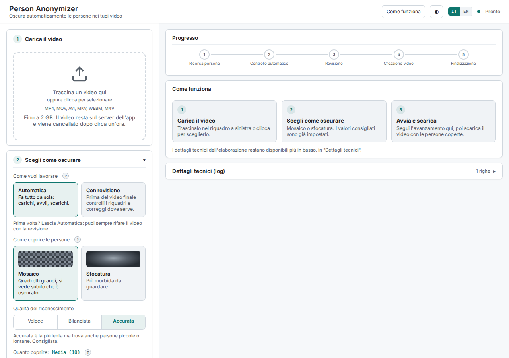

### Architettura

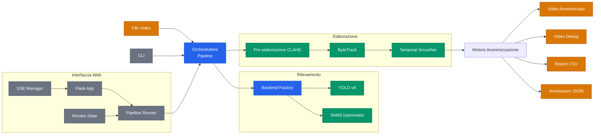

### Funzionalità

- **Rilevamento YOLO v8 multi-scala**: inferenza a 4 scale (1.0x-2.5x) + sliding window 3x3 + Test-Time Augmentation
- **Tracking ByteTrack**: ID persona persistenti tra frame consecutivi
- **Temporal smoothing (EMA)**: stabilizza i riquadri con una media mobile; i ghost box tengono coperte le persone durante le occlusioni brevi
- **Controllo e refinement automatici**: ri-analizza il video renderizzato e aggiunge le persone sfuggite (fino a 3 passaggi)
- **Revisione manuale**: aggiungi, chiudi ed elimina aree frame per frame, nel browser (web) o in una finestra OpenCV (CLI)
- **Due metodi di oscuramento**: pixelation (mosaico, default) o blur gaussiano
- **Intensità adattiva**: le persone piccole e lontane ricevono un oscuramento più forte
- **Riprendi un lavoro salvato**: ricarica le annotazioni JSON di un'elaborazione precedente e rivedile, oppure trasformale in rettangoli e passa direttamente al video
- **Output completo**: video H.264 anonimizzato con l'audio originale, video debug, report CSV, annotazioni JSON riutilizzabili
- **Backend SAM3 opzionale**: maschere precise al pixel invece dei riquadri (vedi [Backend SAM3](#backend-sam3-opzionale))

### Requisiti

- Python 3.11+ (3.12+ per il backend SAM3)
- ffmpeg (encoding H.264 e preservazione dell'audio)
- ~150 MB di spazio disco per i modelli YOLO (scaricati automaticamente al primo avvio)
- GPU CUDA consigliata; funziona anche su CPU (CUDA obbligatoria per le modalità SAM3)

**Installare ffmpeg:**

```bash
# Ubuntu/Debian
sudo apt install ffmpeg

# macOS
brew install ffmpeg

# Windows (Chocolatey)
choco install ffmpeg
```

### Installazione

```bash
git clone https://github.com/AndreaBonn/video-anonimyzer.git
cd video-anonimyzer
python -m venv .venv
source .venv/bin/activate
# Windows: .venv\Scripts\activate
pip install -e .
```

`pip install -e .` installa le dipendenze pinnate e il comando `person-anonymizer`. `requirements.txt` contiene gli stessi pin di produzione, `requirements-dev.txt` aggiunge gli strumenti di test e lint.

### Interfaccia Web

```bash
python -m person_anonymizer.web.app
# Apri http://127.0.0.1:5000 nel browser
```

La pagina guida chi la usa per la prima volta in tre passi: carica il video, scegli come oscurare, avvia e scarica. I valori consigliati sono già impostati, quindi un video si elabora senza toccare alcuna impostazione.

<p align="center">
  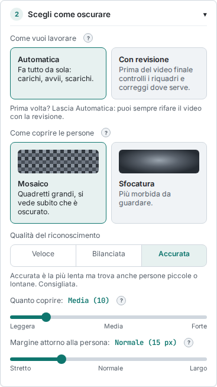
  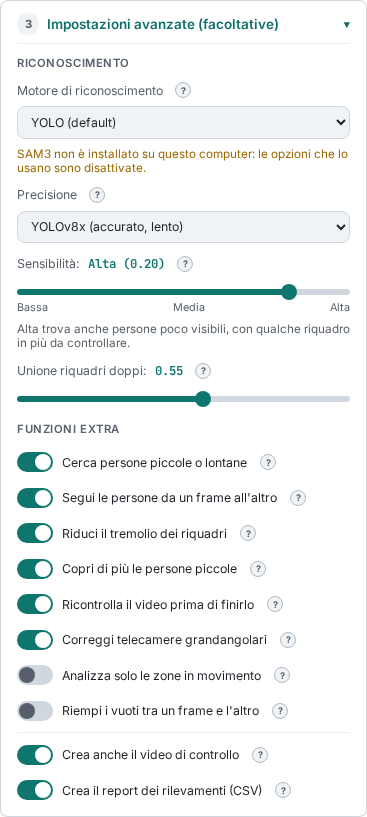
</p>

**1. Carica il video.** Trascinalo o clicca per sceglierlo (MP4, MOV, AVI, MKV, WEBM, M4V, fino a 2 GB). La scheda mostra anteprima, durata e risoluzione.

**2. Scegli come oscurare.**

| Impostazione | Opzioni | Note |
|--------------|---------|------|
| Come vuoi lavorare | **Automatica** (default nella web UI) o **Con revisione** | Con revisione si ferma prima del video finale per controllare le aree |
| Come coprire le persone | **Mosaico** o **Sfocatura** | Anteprima visiva su ogni scelta |
| Qualità del riconoscimento | **Veloce**, **Bilanciata**, **Accurata** (default) | Veloce = YOLOv8n senza sliding window; Bilanciata = YOLOv8n + sliding window; Accurata = YOLOv8x + sliding window |
| Quanto coprire | Da Leggera a Forte | `anonymization_intensity` |
| Margine attorno alla persona | Da Stretto a Largo | `person_padding` in px |

**3. Impostazioni avanzate (facoltative, chiuse di default).** Motore di riconoscimento (YOLO, YOLO + SAM3, SAM3; le opzioni SAM3 sono disattivate se SAM3 non è installato), modello YOLO, sensibilità (tradotta nella soglia di confidenza YOLO: più sensibilità significa soglia più bassa), unione dei riquadri doppi (NMS IoU) e le funzioni extra: persone piccole o lontane (sliding window), tracking, smoothing, intensità adattiva, controllo finale, correzione grandangolare, analisi delle sole zone in movimento, interpolazione sub-frame, video di controllo e report CSV.

**Riprendi un lavoro salvato.** Carica prima lo stesso video, poi il `*_annotations.json` di un'elaborazione precedente: il rilevamento viene saltato e la revisione si apre nel browser. Con "Trasforma le aree in rettangoli" (come `--normalize`) le aree diventano rettangoli, quelle sovrapposte vengono unite e il video si crea senza revisione.

**Progresso.** Cinque fasi con barra di avanzamento, stima del tempo e contatore dei frame. Durante l'elaborazione le impostazioni sono bloccate; Interrompi chiede conferma. Ricaricando la pagina, questa si ricollega all'elaborazione ancora in corso, che si può seguire o interrompere. Il server esegue un'elaborazione alla volta.

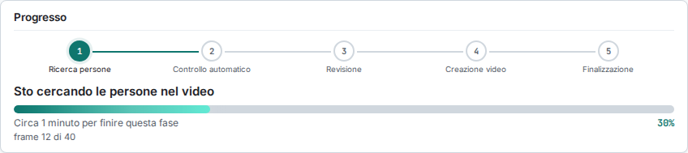

**Revisione manuale nel browser.** Le aree verdi sono state trovate in automatico, quelle arancioni le hai aggiunte tu. Disegna un'area punto per punto, chiudila, elimina le aree sbagliate, salta al prossimo frame con persone. Ogni modifica viene salvata sul server; una modifica che il server rifiuta viene annullata anche a schermo.

<p align="center">
  
</p>

| Tasto | Azione |
|-------|--------|
| Click | Aggiungi un punto |
| Enter | Chiudi l'area |
| D | Modalità elimina |
| Esc | Annulla l'area in corso |
| Sinistra / Destra, Spazio | Frame precedente / successivo |
| Ctrl+Z | Annulla l'ultimo punto |

**Risultati.** Player di anteprima, download del video anonimizzato, esito del controllo automatico e gli altri file (file per riprendere il lavoro, video di controllo, report CSV). I file vengono cancellati dopo circa un'ora.

<p align="center">
  
</p>

L'interfaccia è disponibile in italiano e in inglese, con tema chiaro e scuro (segue l'impostazione di sistema finché non ne scegli uno). Il pulsante "Come funziona" riapre la guida, e il log tecnico resta disponibile in "Dettagli tecnici", senza percorsi assoluti.

<p align="center">
  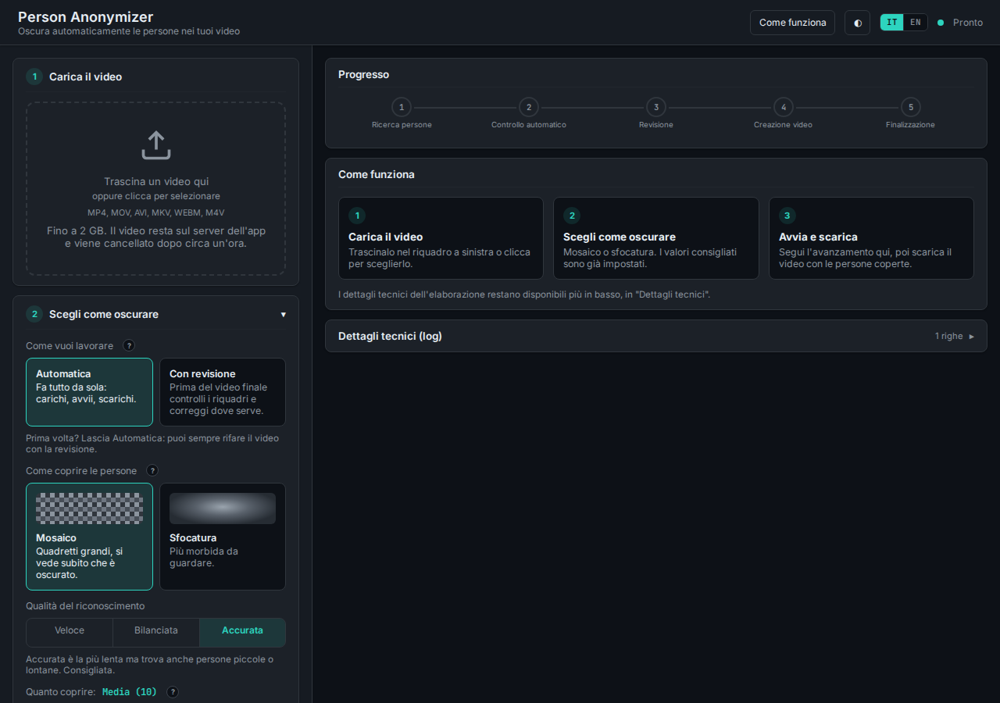
</p>

**Variabili d'ambiente:**

| Variabile | Descrizione | Default |
|-----------|-------------|---------|
| `FLASK_SECRET_KEY` | Chiave segreta per le sessioni Flask | Random (generata all'avvio, con un avviso) |
| `FLASK_HOST` | Host del server web | `127.0.0.1` |
| `FLASK_PORT` | Porta del server web | `5000` |

### Utilizzo CLI

```bash
# Standard: rilevamento automatico + revisione manuale (default della CLI)
python -m person_anonymizer.cli video.mp4
# oppure, dopo pip install -e .
person-anonymizer video.mp4

# Completamente automatico (senza revisione)
python -m person_anonymizer.cli video.mp4 -M auto

# Specificare output e metodo
python -m person_anonymizer.cli video.mp4 -o output.mp4 -m blur

# Disabilitare video debug e report CSV
python -m person_anonymizer.cli video.mp4 --no-debug --no-report

# Ricaricare le annotazioni JSON e riaprire la revisione (il rilevamento viene saltato)
python -m person_anonymizer.cli video.mp4 --review annotazioni.json

# Normalizzare le annotazioni (poligoni in rettangoli, sovrapposizioni unite) e creare il video senza revisione
python -m person_anonymizer.cli video.mp4 --review annotazioni.json --normalize
```

**Opzioni CLI:**

| Opzione | Descrizione | Default |
|---------|-------------|---------|
| `input` | Percorso del video da elaborare | (obbligatorio) |
| `-M, --mode` | `manual` (con revisione) o `auto` | `manual` (da `PipelineConfig`) |
| `-o, --output` | Percorso del file di output | `<input>_anonymized.mp4` |
| `-m, --method` | `pixelation` o `blur` | `pixelation` (da `PipelineConfig`) |
| `--backend` | Backend di rilevamento: `yolo`, `yolo+sam3`, `sam3` | `yolo` |
| `--no-debug` | Disabilita il video debug | `False` |
| `--no-report` | Disabilita il report CSV | `False` |
| `--review` | Ricarica le annotazioni da JSON | `None` |
| `--normalize` | Trasforma i poligoni in rettangoli e salta la revisione (richiede `--review`) | `False` |

**Finestra di revisione CLI (OpenCV):** click per aggiungere un punto, Enter per chiudere l'area, D per la modalità elimina, Esc per annullare, Sinistra/Destra o Spazio per spostarsi tra i frame, Ctrl+Z o Backspace per annullare un punto, Q per terminare.

### Pipeline (5 fasi)

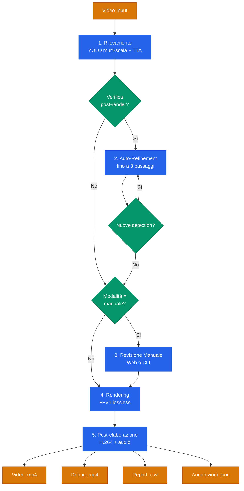

| # | Fase | Etichetta web | Cosa succede |
|---|------|---------------|--------------|
| 1 | Rilevamento | Ricerca persone | YOLO multi-scala + sliding window + TTA, tracking e smoothing; motion detection opzionale. Saltata quando le annotazioni vengono ricaricate da JSON |
| 2 | Auto-refinement | Controllo automatico | Renderizza, esegue un secondo passaggio YOLO sul risultato e aggiunge le persone sfuggite, fino a 3 iterazioni |
| 3 | Revisione manuale | Revisione | Editor nel browser o finestra OpenCV; saltata in modalità automatica |
| 4 | Rendering | Creazione video | Applica l'oscuramento ai frame originali (intermedio FFV1 lossless) |
| 5 | Post-processing | Finalizzazione | Encoding H.264 con ffmpeg, audio originale, video debug, report e JSON |

### File di Output

| File | Descrizione |
|------|-------------|
| `*_anonymized.mp4` | Video con le persone oscurate (H.264, audio originale) |
| `*_debug.mp4` | Video con overlay colorati delle detection |
| `*_report.csv` | Una riga per frame: persone rilevate, confidenza media/minima/massima, zone di movimento, hit di sliding window e multi-scala, alert del controllo finale |
| `*_annotations.json` | Annotazioni complete, riutilizzabili con `--review` o "Riprendi un lavoro salvato" |

### Formati Supportati

`.mp4`, `.m4v`, `.mov`, `.avi`, `.mkv`, `.webm`

### Backend SAM3 (Opzionale)

Oltre alla pipeline YOLO predefinita, Person Anonymizer supporta **SAM3 (Segment Anything Model 3 di Meta)** come backend opzionale di rilevamento e segmentazione, che produce maschere delle persone precise al pixel al posto dei bounding box.

| Modalità | Descrizione | Requisiti GPU |
|----------|-------------|---------------|
| `yolo` | Default: YOLO v8 multi-scala (rapido, collaudato) | CUDA consigliata, supporta anche CPU |
| `yolo+sam3` | Ibrida: YOLO rileva, SAM3 raffina le maschere | CUDA **obbligatoria** |
| `sam3` | SAM3 completo: rilevamento e segmentazione tramite SAM3 | CUDA **obbligatoria**, 8+ GB VRAM |

```bash
# Installare le dipendenze SAM3 (Python 3.12+)
pip install -r requirements-sam3.txt
# oppure
pip install -e '.[sam3]'

# Modalità ibrida
python -m person_anonymizer.cli video.mp4 --backend yolo+sam3

# Modalità SAM3 completo
python -m person_anonymizer.cli video.mp4 --backend sam3
```

Nell'interfaccia web il motore si sceglie in "Impostazioni avanzate". La pagina chiede al server se SAM3 è installato e, se non lo è, disattiva le opzioni che lo usano; con SAM3 completo il selettore del modello YOLO viene nascosto.

### Configurazione Avanzata

Tutti i parametri (circa 50) stanno in `PipelineConfig` (`person_anonymizer/config.py`), validati in `__post_init__`. L'interfaccia web espone i più utili. I principali:

| Parametro | Descrizione | Default | Range |
|-----------|-------------|---------|-------|
| `operation_mode` | `manual` o `auto` | `manual` | |
| `detection_confidence` | Soglia di confidenza YOLO | 0.20 | 0.01-0.99 |
| `anonymization_intensity` | Intensità dell'oscuramento | 10 | 1-100 (web: 2-50) |
| `person_padding` | Margine attorno alla persona (px) | 15 | 0-200 (web: 0-60) |
| `yolo_model` | Modello YOLO | `yolov8x.pt` | `yolov8x.pt`, `yolov8n.pt` |
| `enable_sliding_window` | Griglia sliding window 3x3 | `True` | |
| `enable_tracking` | Tracking ByteTrack | `True` | |
| `track_max_age` | Frame per cui si conserva una traccia persa | 45 | web: 1-300 |
| `enable_temporal_smoothing` | EMA + ghost box | `True` | |
| `smoothing_alpha` | Peso EMA (1 = nessuno smoothing) | 0.35 | 0.01-1.0 |
| `ghost_frames` | Frame ghost per le occlusioni | 10 | 0-120 |
| `enable_adaptive_intensity` | Intensità proporzionale alla dimensione | `True` | |
| `enable_post_render_check` | Controllo e refinement automatici | `True` | |
| `max_refinement_passes` | Iterazioni di auto-refinement | 3 | 1-10 |
| `enable_motion_detection` | Esegue la sliding window solo sulle zone in movimento (il multi-scala copre comunque tutto il frame) | `False` | |
| `enable_subframe_interpolation` | Riempie i vuoti tra i frame | `False` | |

**La correzione fish-eye** richiede una calibrazione della camera: esegui `python -m person_anonymizer.camera_calibration --images ./calibration_images/` su foto di una scacchiera, poi imposta `camera_matrix` e `dist_coefficients` in `PipelineConfig`. Né la CLI né l'interfaccia web caricano un file di calibrazione, quindi senza questi due valori l'interruttore della correzione non ha effetto.

### Struttura del Progetto

```
person_anonymizer/
├── config.py              # PipelineConfig con validazione, VERSION
├── models.py              # Dataclass (PipelineContext, OutputPaths, ...) ed eccezioni
├── pipeline.py            # Orchestratore: ordine delle fasi, stop, ciclo di vita del capture
├── pipeline_report.py     # Path di output, banner e riepilogo stampato
├── stage_detection.py     # Loop di rilevamento (YOLO + tracking + smoothing, refiner SAM3 opzionale)
├── detection_report.py    # Righe di report per frame e totali del rilevamento
├── stage_refinement.py    # Loop di controllo e refinement automatico
├── stage_review.py        # Revisione manuale (web o CLI)
├── backend_factory.py     # Selezione del backend: yolo / yolo+sam3 / sam3
├── sam3_backend.py        # Backend SAM3 opzionale
├── detection.py           # YOLO multi-scala + NMS
├── tracking.py            # ByteTrack + TemporalSmoother
├── anonymization.py       # Oscuramento + geometria dei poligoni
├── preprocessing.py       # CLAHE, fisheye, motion detection
├── postprocessing.py      # Encoding H.264, verifica post-render
├── normalization.py       # Merge dei poligoni e normalizzazione delle annotazioni
├── rendering.py           # Rendering video + statistiche di revisione
├── output.py              # Salvataggio output e caricamento JSON
├── manual_reviewer.py     # Finestra di revisione OpenCV
├── review_editor.py       # Stato e azioni dell'editor di revisione (puro)
├── review_drawing.py      # Disegno di overlay e barre di stato (puro)
├── camera_calibration.py  # Utility di calibrazione camera
├── cli.py                 # Entry point CLI
└── web/                   # Interfaccia web Flask (Blueprint)
    ├── app.py             # Route upload/start/stop/status, stream SSE, thread di cleanup
    ├── routes_review.py   # Endpoint di revisione
    ├── routes_output.py   # Endpoint di download, default e capabilities
    ├── pipeline_runner.py # Thread in background attorno a run_pipeline
    ├── review_state.py    # Stato della revisione thread-safe
    ├── sse_manager.py     # Server-Sent Events
    ├── middleware.py      # CSRF, security header, request ID
    ├── upload_validation.py, config_validator.py, job_cleanup.py, ...
    ├── templates/         # index.html
    └── static/            # CSS, JS (i18n, impostazioni, progresso, editor di revisione, risultati)
tests/                     # oltre 1.100 test (pytest)
reports/                   # Report di audit
```

### Sviluppo

```bash
source .venv/bin/activate
pip install -r requirements-dev.txt
python -m pytest -q
ruff check .
```

### Dettagli Architetturali

Vedi [docs/ARCHITECTURE.md](docs/ARCHITECTURE.md) per i diagrammi tecnici dettagliati: internals della pipeline di rilevamento, sequenza della revisione web, decision tree della backend factory.

### Sicurezza

Vedi [SECURITY.md](SECURITY.md) per i dettagli completi sulle protezioni implementate. L'interfaccia web non ha autenticazione: è pensata per uso locale o in intranet.

### Tecnologie

- [Ultralytics YOLOv8](https://github.com/ultralytics/ultralytics): object detection
- [Meta SAM3](https://github.com/facebookresearch/segment-anything-3): segmentazione precisa al pixel (opzionale)
- [ByteTrack](https://github.com/ifzhang/ByteTrack): multi-object tracking
- [OpenCV](https://opencv.org/): elaborazione video
- [Flask](https://flask.palletsprojects.com/): interfaccia web
- [ffmpeg](https://ffmpeg.org/): encoding video

### Licenza

Questo progetto è rilasciato sotto [Apache License 2.0](LICENSE).

> **Nota**: Questo progetto dipende da [Ultralytics YOLOv8](https://github.com/ultralytics/ultralytics), rilasciato sotto AGPL-3.0. Se si utilizza questo software come servizio di rete, l'AGPL richiede che il codice sorgente completo sia reso disponibile. Essendo questo progetto già open source, non c'è conflitto pratico. Per uso commerciale/proprietario di YOLO, vedere [Ultralytics Licensing](https://www.ultralytics.com/license).

Gli screenshot usano una clip ricavata da `bus.jpg`, l'immagine di esempio distribuita con Ultralytics.

### Sostieni il progetto

Person Anonymizer è gratuito. Se ti è utile e vuoi contribuire, puoi lasciare un'offerta tramite PayPal. L'importo lo scegli tu ed è del tutto facoltativo.

<div align="center">

[](https://paypal.me/AndreaBonacci19)

</div>
