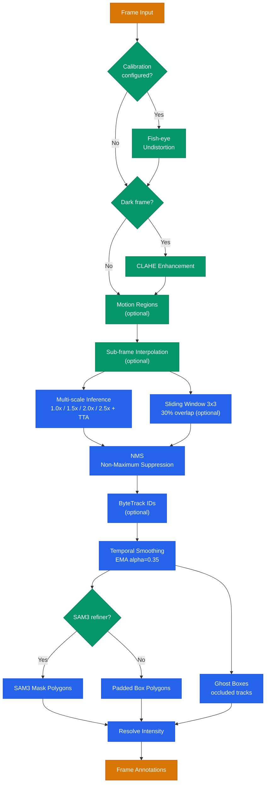
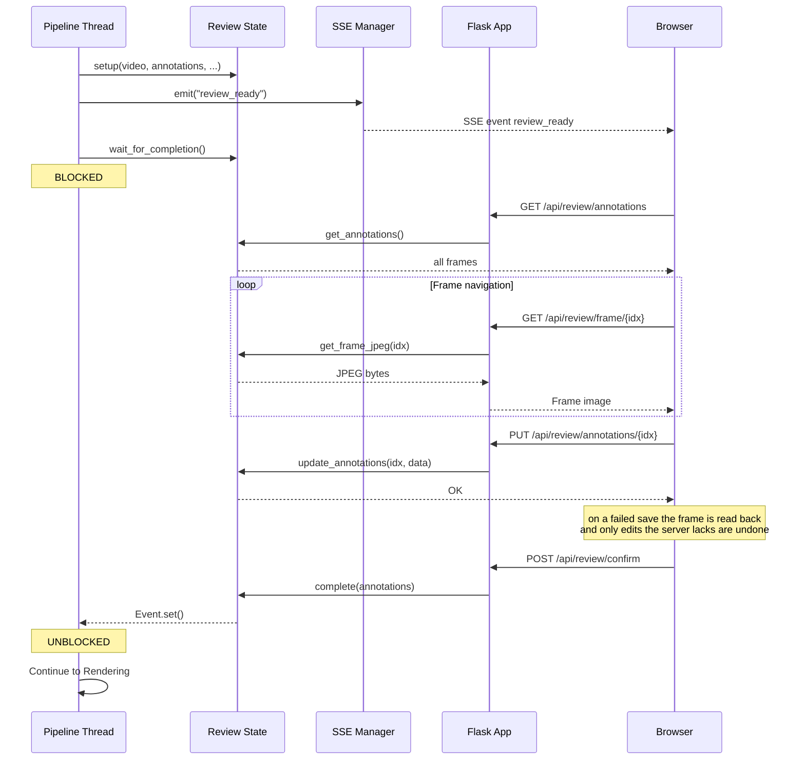
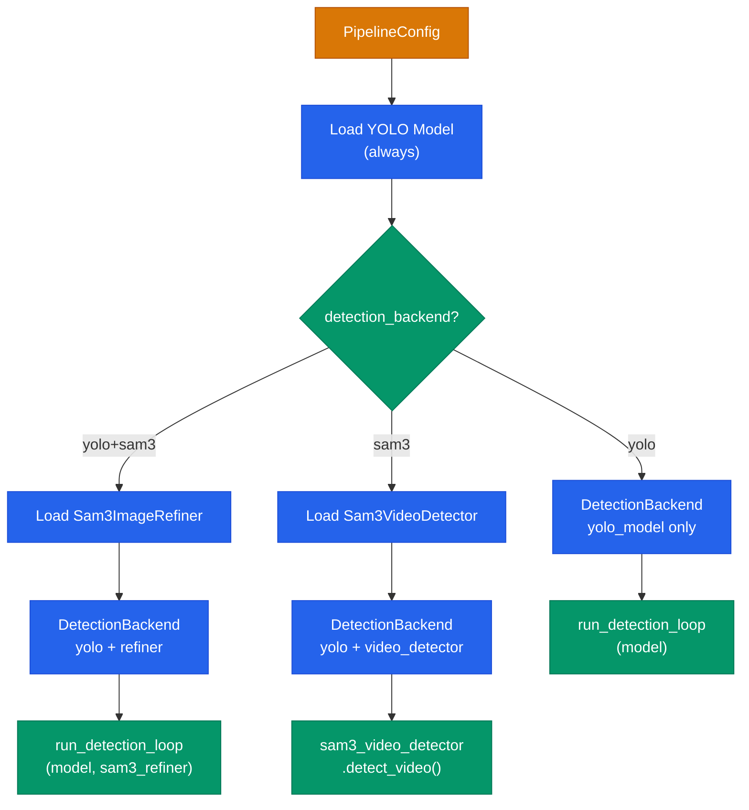

# Architecture - Person Anonymizer

Technical diagrams for the detection pipeline, web review interaction, and backend selection.

For the high-level overview and pipeline flow, see the [README](../README.md).

---

## Detection Stage Internals

`run_detection_loop` in `stage_detection.py` reads the video and passes each frame through named steps (`_process_single_frame`). The frame is first undistorted when a camera calibration is configured. CLAHE enhancement applies only to dark frames (mean gray level below `quality_darkness_threshold`, default 60). With sub-frame interpolation on, virtual frames between the previous and the current one are detected too. Detection runs multi-scale inference at 4 scales plus, when enabled, a 3x3 sliding window with 30% overlap; with motion detection on, only the patches that intersect a moving area are analyzed. After NMS, ByteTrack assigns an identity to every box (it never drops a detection, it only labels it), temporal smoothing (EMA) stabilizes the boxes, and each box becomes a polygon: SAM3-refined in the `yolo+sam3` mode, padded rectangle otherwise. Ghost boxes keep anonymization active for people that are briefly occluded.

In the `sam3` mode this loop is not used: `Sam3VideoDetector.detect_video()` processes the whole video.

**Key modules:** `stage_detection.py` (per-frame steps), `detection.py` (multi-scale + sliding window + NMS), `tracking.py` (ByteTrack wrapper + TemporalSmoother), `preprocessing.py` (undistortion, CLAHE, motion detection, interpolation), `detection_report.py` (per-frame CSV rows).

---

## Web Review Sequence

The pipeline thread blocks in the review phase until the user confirms the annotations in the browser. This happens when the mode is `manual`, and also when a saved JSON is resumed without normalization: `load_annotations_from_json` forces the manual review, and `PipelineRunner` wires the browser review for that case too, so it never falls back to an OpenCV window on the server. `ReviewState` bridges the pipeline thread and the Flask request threads with `threading.Event`; SSE pushes progress and the `review_ready` event to the browser.

**Save consistency.** A `PUT` can reach the server while its response is lost. On a failure `review-sync.js` reads the frame back from `GET /api/review/annotations` and undoes only the edits the server does not hold, so the canvas never shows an area the final video would not blur (or the reverse).

**Reattach after reload.** On load the page asks `GET /api/status`. If a job is still running it restores Stop and the progress view and subscribes to `/api/progress` again; earlier events are not replayed. The server runs one job at a time and answers `409` to a second start.

**Key modules:** `web/review_state.py` (thread-safe state bridge), `web/sse_manager.py` and `web/sse_stream.py` (event distribution and framing), `web/routes_review.py` (REST endpoints), `web/pipeline_runner.py` (job thread and review wiring), `stage_review.py` (pipeline integration), `static/js/review-editor.js` and `static/js/review-sync.js` (browser editor and save reconciliation).

---

## Backend Factory - Detection Mode Selection

`backend_factory.py` implements the factory pattern for detection backends. YOLO is always loaded as the base model. SAM3 components are conditionally loaded based on the `detection_backend` config parameter.

| Mode | Detection | Segmentation | GPU Requirement |
|------|-----------|--------------|-----------------|
| `yolo` | YOLO v8 multi-scale | Bounding box to polygon | CUDA recommended, CPU supported |
| `yolo+sam3` | YOLO v8 | SAM3 refines masks per-frame | CUDA required |
| `sam3` | SAM3 end-to-end | SAM3 pixel-precise masks | CUDA required, 8+ GB VRAM |

The web interface reads `GET /api/capabilities` to know whether SAM3 is installed and disables the SAM3 options when it is not.

**Key modules:** `backend_factory.py` (factory + `DetectionBackend` dataclass), `sam3_backend.py` (`Sam3ImageRefiner`, `Sam3VideoDetector`).
